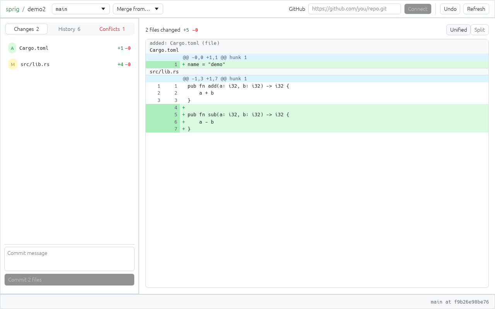
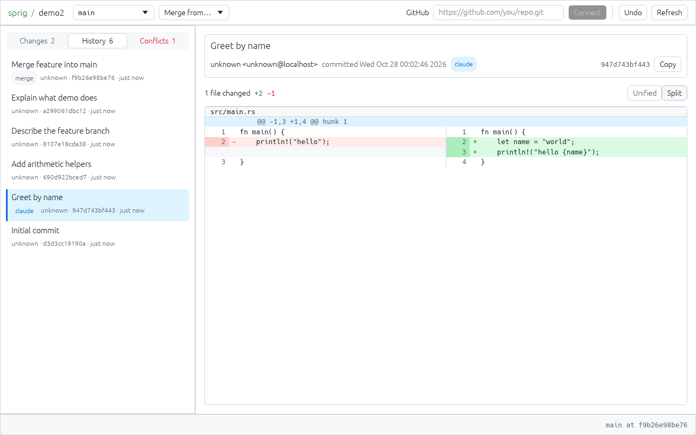
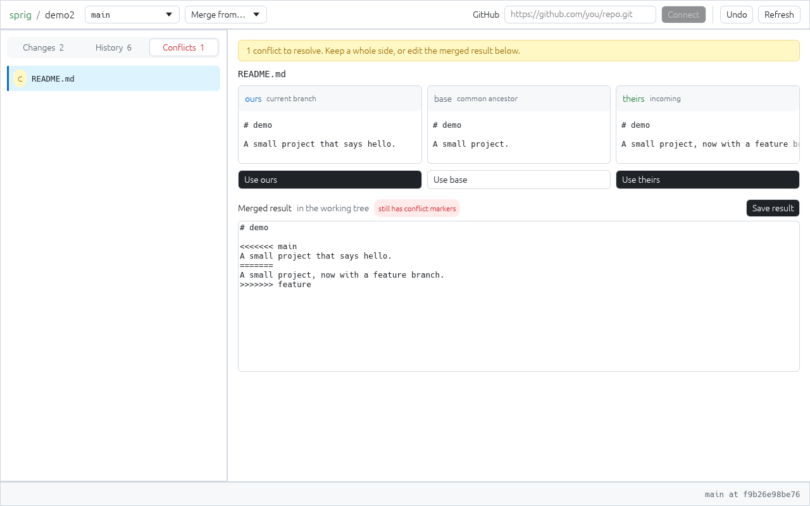
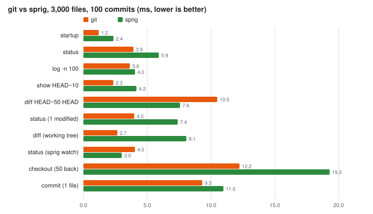
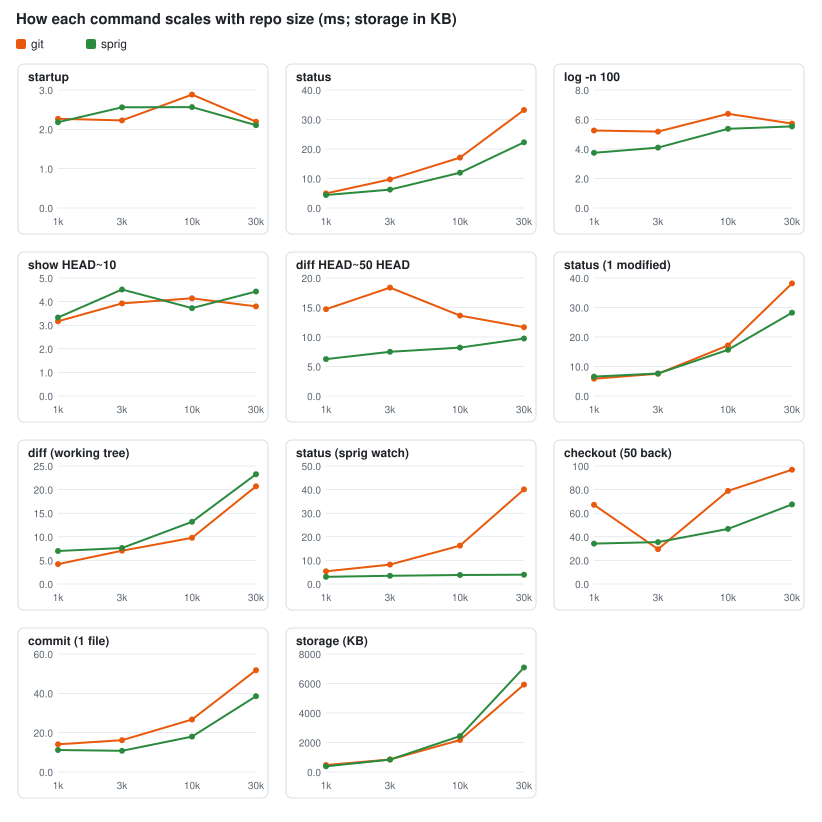

# sprig

A small version control system built for a world where most commits come
from agents. It is a hybrid: the storage is content-addressed and
distributed like git, and a server exposes the repository as an API so
always-online tools can ask questions without cloning.

Prototype, about 8,900 lines of Rust plus 1,800 of tests. It was first
written in Go; the Rust version reads and writes the same repositories,
packs and wire protocol (byte for byte: importing the same git history gives
the same change ids). Dependencies are pinned in `Cargo.lock` and were
checked with `cargo audit` (see [Dependencies](#dependencies)).

## Install

You need:

- **Rust 1.89 or newer** (`rustc --version`), from rustup.rs or your
  package manager.
- **A C compiler** (gcc or clang). The tree-sitter grammars and zstd are C
  and are compiled by cargo.
- **git**, only for `import-git`/`export-git` and for fetching the source.

| System | Command |
|---|---|
| Fedora / RHEL | `sudo dnf install rust cargo gcc git` |
| Debian / Ubuntu | `sudo apt install gcc git`, then Rust from rustup.rs (Debian's is often too old) |
| Arch | `sudo pacman -S rust gcc git` |
| macOS | `xcode-select --install` (clang and git), then `brew install rust` |
| Windows | Rust from rustup.rs with the MSVC build tools. Untested; `sprig watch` is Unix only. |

Build and put it on your PATH:

```sh
git clone https://github.com/domeepc/sprig.git
cd sprig
cargo install --locked --path .    # installs to ~/.cargo/bin
sprig version
```

Tab completion of commands, flags, branches, remotes and conflicted paths:

```sh
echo 'eval "$(sprig completion bash)"' >> ~/.bashrc
echo 'source <(sprig completion zsh)' >> ~/.zshrc      # after compinit
sprig completion fish > ~/.config/fish/completions/sprig.fish
```

The scripts are a few lines that ask `sprig __complete` what fits, so
completion knows your branches and remotes and never goes out of date.

`~/.cargo/bin` must be on your PATH (rustup sets that up). To build without
installing: `cargo build --release`, which leaves the binary in
`target/release/sprig`.

Check the build with `cargo test --release`.

Optional setup:

- `sprig keygen`: sign your changes (key in `~/.config/sprig/`).
- `SPRIG_AUTHOR="Name <email>"`: author for your changes (see
  [Environment](#environment)).
- `sprig watch` in a repo you work in a lot keeps `status` fast.
- Running a server: see `sprig serve` under [Quick tour](#quick-tour).

To update: `git pull && cargo install --locked --path .`.
To uninstall: `cargo uninstall sprig`, and delete `~/.config/sprig` if you made a key.

## Desktop app

`sprig-ui` is a native window on a repository (Rust, egui), for Linux,
macOS and Windows:

- **Inbox**: what needs you, in sections: conflicts HEAD recorded, the
  working tree with +N −N per file, agent changes without a passing
  `review` check (what `sprig audit` reports), and recent changes. Filter
  by All, Agents or People.
- **Sidebar**: branch switcher, the pages, who made changes this week
  (agents and people), and the GitHub card with how far the branch is
  ahead of or behind GitHub, Pull and Push.
- **Changes**: the working tree against HEAD and a diff with line numbers
  (unified or side by side); commit everything or the selected file.
- **History** and a page per change: its provenance (agent, model,
  intent, checks, signature, parents, recorded conflicts) beside its diff.
- **Merge** another branch from the header; pull and push with sprig
  servers (`sprig remote add`), and with GitHub or any git host: enter the
  repository URL once, then Pull (fetch and merge) and Push. git does the
  network part with your own credentials (SSH key or credential helper).
- **Conflicts**: ours, base and theirs side by side; take one side, or edit
  the result and save it, then commit.
- **Undo** of the last operation (again = redo).

Each button runs the same code as the matching command (`checkout`,
`merge`, `pull`, `github pull`...), so the app and the CLI behave the same
and everything lands in `sprig ops`.

```sh
cargo install --locked --path . --features ui   # installs sprig and sprig-ui
sprig-ui path/to/repo                           # or run it inside the repo
```

Linux needs the usual desktop libraries (X11 or Wayland, OpenGL, and
`libxkbcommon-x11`), present on any desktop install.







#### Design

The design system lives in one place, `theme` in `src/bin/sprig-ui.rs`:
color, radius and spacing tokens, plus a few components (card, primary
button, pill, +N −N counts, banner, list row). The patterns come from
source-control screens on [Mobbin](https://mobbin.com):

| Pattern | Taken from |
|---|---|
| Dark theme: near-black neutral canvas, bordered cards, blue "Publish" primary button, green/red +N −N | Graphite PR inbox and PR page, re-tinted for dark ([1](https://mobbin.com/screens/3e2205a5-5840-410b-abb3-38ea45add32a), [2](https://mobbin.com/screens/24233aed-0981-4a40-a745-451ee3416edc), [3](https://mobbin.com/screens/743e36e2-c364-4d55-b1d5-5e326efcecfe)) |
| Bordered cards, blue selection; history rows with a title and an "author · sha · time" line | GitHub commit list and compare ([1](https://mobbin.com/screens/74b0d6a5-8630-4cea-9a70-d7a3338e802d), [2](https://mobbin.com/screens/13c9c426-fbb5-4b38-be81-d2a88cd89fdc), [3](https://mobbin.com/screens/6da8411f-4296-446a-ab95-e57456a48714)) |
| Diff with line-number gutters, tinted added and removed lines, "+23 −0" per file, Unified/Split switch | GitLab commit diff ([1](https://mobbin.com/screens/95e376da-81cd-465c-a99b-a0051f9a2baf), [2](https://mobbin.com/screens/5dc51455-c50f-403e-a5bf-ca8e432784b4)), GitHub compare ([3](https://mobbin.com/screens/168fa0b6-a33c-4172-8fe0-984ecc63db45)) |
| Sidebar with the repository, pages and who is working; a change page with provenance beside the diff | Cursor Agents tab ([1](https://mobbin.com/screens/58450174-4034-4e5d-a126-9def2378b0a0), [2](https://mobbin.com/screens/44239877-86ce-46c8-a615-273ec82046f5), [3](https://mobbin.com/screens/facfdb37-d755-40d8-b4c9-40f630d826f3)) |
| Inbox of collapsible sections with a count, rows with avatar, title, checks, +N −N and age | Graphite inbox ([1](https://mobbin.com/screens/a83d8ccd-c487-4e28-8edc-967742f33219), [2](https://mobbin.com/screens/dad262d6-6b54-4c72-989d-8390413a2d6a)) |
| Segmented Changes / History / Conflicts switch, file rows with +N −N | Cursor Git panel ([1](https://mobbin.com/screens/d744068a-1835-4c35-afa2-e560ccbe565d), [2](https://mobbin.com/screens/cb7068e4-44d5-4f04-9c5c-855782a96309), [3](https://mobbin.com/screens/bc80d597-15fe-4a3d-b09f-7bb7fda745b3)) |
| AI-review layout: file list with counts beside a split diff | Mobbin has no CodeRabbit screens; the closest AI review tools stood in: Devin ([1](https://mobbin.com/screens/aeaed0d8-a1c1-4094-8615-c34f45cc7c45)), Graphite ([2](https://mobbin.com/screens/8dbeb6a4-fddd-4e76-ad84-8590cb61f8b7)), Replit ([3](https://mobbin.com/screens/e92dd0ec-6660-4610-930a-38900c351734)) |
| Conflicts: a warning strip, sides as columns with one "keep this side" button each | Front merge review ([1](https://mobbin.com/screens/0ecf2195-42d2-4db8-a7c4-46a176759c17)), Codecademy compare ([2](https://mobbin.com/screens/3db54285-08df-44c3-a226-cf3e168b5e85)) |

The same GitHub sync works from the command line: `sprig github set <url>`,
then `sprig github pull` and `sprig github push` (it keeps a bare mirror in
`.sprig/github.git` and uses `import-git`/`export-git`, described below).
SSH URLs (`git@github.com:you/repo.git`) use your ssh-agent and keys as
plain git does; `sprig github key ~/.ssh/deploy_key` picks one key (a
deploy key, say) for this repository, `sprig github key ''` drops it.

## What's different from git

| Idea | How sprig does it |
|---|---|
| **Provenance is structured** | A *change* (sprig's commit) carries `intent`, `agent`, `model`, and `checks` (e.g. `tests=pass`, `review=approved`) as fields, not as text in the message. `sprig log --agent X` and `sprig audit` query them. Changes can be signed (ed25519), so `audit --signed` can tell who really made them. |
| **Conflicts are data** | A conflicted merge still *completes*. The conflicts are recorded inside the merge change, the files get markers, and you keep working. `sprig conflicts` lists them; they carry forward until the file is fixed. |
| **Everything is undoable** | Every command that moves a branch or HEAD is written to an operation log with the before/after state. `sprig undo` reverts the last one, including merges, and undoing an undo redoes it. |
| **API first** | `sprig serve` exposes refs, history, files and directory listings as JSON/HTTP. A CI job can read `main:src/x.go` with one GET. Every CLI command that reads has `--json`. |
| **Server-side landing** | `sprig land` (or one POST) sends just the edited files; the server merges them onto the current tip and retries if someone landed first. Agents need no clone, and nothing queues behind a global lock. |
| **Server-side policy** | The server refuses ref updates that are non-fast-forward, point at an unknown change, or whose tip has unresolved conflicts. Objects are hash-verified and only accepted once everything they reference is present, so a ref can never point at partial history. |
| **No index** | No staging area. `commit` snapshots the working tree (minus `.sprigignore`); `commit -m msg <path>...` commits only those paths, and `--hunk path:N` only some hunks of a file. |
| **SHA-256 everywhere** | Objects are `blob`, `tree`, `change`, addressed by SHA-256 and verified on every read, including ones rebuilt from deltas in a pack. |
| **Merges follow renames** | Renames are detected by content (`-M` sets the similarity, default 50%). When one side renames a file and the other edits it, the edit lands in the renamed file; files added to a directory the other side moved follow it. `land` does the same against renames that landed after your base. |
| **Merges understand code** | When a line merge conflicts, sprig retries per import and per top-level declaration for Go, Python, JavaScript/JSX, TypeScript/TSX, Rust and Java (tree-sitter), and per member inside a class, `impl` or Java type both sides changed. Two sides adding imports or functions merge cleanly; the same function changed both ways still conflicts. The result must parse without errors. |

## Quick tour

```sh
sprig init
echo hello > a.txt
SPRIG_AGENT=claude sprig commit -m "add greeting" \
    --intent "user asked for a greeting" --model sonnet --check tests=pass

sprig checkout -b feature    # uncommitted edits come along
...edit, commit...
sprig checkout main
sprig merge feature          # exit code 3 if conflicts were recorded
sprig conflicts
sprig resolve --theirs a.txt
sprig commit -m "resolve"
sprig undo                   # back to the conflicted state
sprig undo                   # and forward again

sprig audit --require review # agent-authored changes without a passing review
sprig commit -m "docs only" README.md docs/   # commit just these paths
sprig diff                                     # hunks are numbered: "@@ ... @@ hunk 2"
sprig commit -m "one fix" --hunk main.go:2     # commit just that hunk
sprig gc [--repack]                            # pack objects, deltas between versions
sprig watch &                                  # optional: status re-checks only changed files
```

### Importing from git

```sh
mkdir myproject-sprig && cd myproject-sprig
sprig init
sprig import-git ../myproject
```

All local branches are converted, with authors, timestamps, messages,
merge structure, symlinks and exec bits kept; the original commit SHA is stored
in `meta.git_sha`. Import is deterministic, so re-running it reproduces the
same ids. Submodules are skipped with a note.

### Landing (server-side commit)

Instead of commit + pull + push, `sprig land` sends only the files you
changed and the change you edited against. The server three-way merges them
onto the branch's current tip, so a stale base is fine unless someone else
touched the same lines. Only the final compare-and-swap of the ref is
serialized; if another landing got in first, the server re-merges onto the
new tip and tries again. Your branch and working tree then move to the
landed change.

```sh
echo fix >> a.txt
sprig land -m "fix a" --intent "flaky test" --check tests=pass
```

Agents and CI don't need a working copy at all. They can read files with
`GET /v1/file` and land with one request:

```sh
curl -X POST $SERVER/v1/land -H "Authorization: Bearer $SPRIG_TOKEN" -d '{
  "branch": "main", "base": "<id from GET /v1/refs>", "message": "bump version",
  "author": "ci <ci@example.com>", "meta": {"agent": "ci"},
  "files": {"VERSION": {"mode": "file", "data": "MS4yLjAK"}, "old.txt": null}}'
```

`data` is base64 and `null` deletes. A conflict returns HTTP 409 with the
paths and the current tip, and nothing lands. Landed changes are linear: one
parent, never a merge. The server only looks up the edited paths and rewrites
the directories along them, so a landing costs about the same whatever the
size of the repository.

### Scaling out: several servers and caches

The ref swap uses an OS file lock (flock on Unix, LockFileEx on Windows), so
several `sprig serve` processes can share one repository directory and land
concurrently. A served repository is durable: object and ref writes are
fsynced before a push or landing is acknowledged, and every ref change is
appended to `reflog.jsonl` (time, ref, old and new id, how, by whom).

A cache server keeps its own copy of objects, which never change once written,
and passes most other requests (refs, log, files) through to the main server.
It does landings itself: it reads the tip from the main server, merges using
its own object copy, uploads only the objects the landing created, and sends
one compare-and-swap of the ref. So caches on any number of machines can take
landing load, and the main server only checks and moves refs:

```sh
sprig init --bare cache.sprig
sprig serve --addr 127.0.0.1:7701 --upstream http://main-host:7700 cache.sprig
```

Point clients at the cache. It checks tokens the same way the main server
does (`--token`, `--tokens`) and fetches from upstream with `SPRIG_TOKEN`.
It keeps a copy of upstream's refs current by long-polling `/v1/refs`, so a
landing starts from the right tip without an extra round trip.
`--upstream` takes a comma-separated list; requests go to the first server
that answers.

A standby mirrors another server read-only, following its refs as they
change:

```sh
sprig init --bare standby.sprig
sprig serve --addr 0.0.0.0:7700 --follow http://main-host:7700 standby.sprig
```

It serves reads and clones and refuses writes (HTTP 503). If the main server
dies, restart the standby without `--follow` and it becomes the main server;
caches listed with `--upstream main,standby` switch over by themselves.

### Partial clones

```sh
sprig clone --path services/api http://127.0.0.1:7700 work
```

This downloads history and directory trees but no file contents. Only files
under `--path` are written to disk; leave `--path` out to check out
everything. Any file content sprig needs later (diff, merge, show) is
downloaded on first use and kept. A merge conflict in a file outside the view
adds that file to the view, so it can be resolved. Files outside the view count as unchanged,
so `commit`, `land` and `push` work as usual.

Change the view later with `sprig sparse <path>...`, or `sprig sparse .` to
check out everything.

### Signed changes

```sh
sprig keygen                       # writes ~/.config/sprig/signing.key (or $SPRIG_KEY)
sprig trust ed25519:AbC... alice   # keys audit --signed accepts
sprig audit --signed --require review
```

With a key, `commit`, `merge` and `land` sign the changes they create, and
`show`/`log` print who signed each one. A landed change is assembled by the
server, so the client signs its request (base, edited paths and contents,
message, metadata). Verification checks that signature and that the server
changed no other path. A signed path may still hold merged content if someone
else edited the same file concurrently.

### Per-directory permissions

```sh
cat > tokens.json <<'JSON'
{ "docs-bot-token-0123456789": ["docs"],
  "api-team-token-0123456789": ["services/api", "libs/common"] }
JSON
SPRIG_TOKEN=admin-secret sprig serve --tokens tokens.json repo.sprig
```

A scoped token can read everything but can only `land`, and only under its
directories. Moving refs directly (`push`) is refused, because that could
carry changes to any path. `SPRIG_TOKEN` stays full access.

To limit reading too, give the token an object:

```json
{ "contractor-token-0123456789": { "write": ["services/api"], "read": ["services/api", "docs"] } }
```

Such a token sees a projection of the repository: every change rebuilt with
only its paths, and changes that touched nothing there left out. Projected
changes are real objects, so the token can `sprig clone`, `fetch`, `log`
and `land` normally; its refs, `/log`, `/changes` and object requests are
answered from the projection, so no file, tree or commit message outside
its paths reaches it. `/file` and `/ls` hide everything else too. A landing
names a projected base; the server maps it back to the real change, merges,
and answers with the projected result. The mapping is stored under
`projections/` and extended as history grows. Projected changes carry
`projected_from` (the real id) and no signature; verify signatures on the
server.

### Pushing to GitHub (or any git host)

sprig has no git protocol of its own; it writes into a local git clone and
git does the pushing. A bare clone works best, since nothing is checked out
there to go stale.

```sh
git clone --bare https://github.com/you/proj proj.git
mkdir proj && cd proj && sprig init
sprig import-git ../proj.git
...work, commit...
sprig export-git ../proj.git
git -C ../proj.git push origin main

# later, bring in commits others pushed
git -C ../proj.git fetch origin '+refs/heads/*:refs/heads/*'
sprig import-git ../proj.git     # fast-forwards your branches
```

If both sides moved a branch, `import-git` keeps git's version as
`git/<branch>`; run `sprig merge git/<branch>` and export again.

Imported history keeps its original git commits, so pushes fast-forward on
GitHub. New changes become commits with `Sprig-Intent`/`Sprig-Agent`/
`Sprig-Model`/`Sprig-Check` trailers and a `Sprig-Change` id, which
`import-git` maps back to the same change instead of duplicating it. Export is
deterministic, branch updates must fast-forward, and tips with unresolved
conflicts are skipped (`--force` overrides both).

### Server and remotes

```sh
sprig init --bare repo.sprig
SPRIG_TOKEN=secret sprig serve --addr 127.0.0.1:7700 repo.sprig

# in a working copy
export SPRIG_TOKEN=secret
sprig remote add origin http://127.0.0.1:7700
sprig push            # fast-forward only unless -f
sprig pull            # fetch + merge (fast-forwards when possible)
```

The server won't listen on a non-loopback address without a token (or
`--tokens`). Remotes must be sprig servers; a GitHub URL is refused with a
pointer to `export-git` (see above).

API (all paths under `/v1`, bearer token when configured):

| Method | Path | Returns |
|---|---|---|
| GET | `/refs?wait=<etag>` | all refs and their etag; with `wait`, blocks until they differ from it (up to 25 s) |
| GET | `/log?ref=main&limit=50` | changes with metadata |
| GET | `/changes/{id}` | one change |
| GET | `/file?ref=main&path=src/x.go` | file contents |
| GET | `/ls?ref=main&path=src` | directory listing |
| GET/PUT | `/object/{id}` | one raw object (transport) |
| POST | `/objects/get` | many objects `{ids}` as a record stream (transport) |
| POST | `/objects/put` | upload a record stream, dependencies first (transport) |
| POST | `/objects/missing` | which of the given ids the server lacks |
| POST | `/refs/{name}` | compare-and-swap ref update `{old,new,force}` (full-access token only) |
| POST | `/land` | apply edits onto a branch tip server-side (see Landing) |

A record is `<id> <type> <len>\n` followed by `<len>` bytes; every object is
hash-checked on arrival.

### Storage and gc

New objects are written loose, one zlib file each. `sprig gc` moves them into
a pack: each file and directory version is stored as a delta against its
previous version (line-based or byte-level, whichever is smaller), trees in a
compact binary form, everything zstd-compressed, and the result is read back
and hash-checked before any loose copy is deleted. Once more than 8 packs
exist, or with `--repack`, gc merges them into one. Commands that add objects
(commit, merge, land, fetch, server uploads) start `sprig gc --auto` in the
background when about 6,400 loose objects have piled up; `gc.lock` keeps runs
from overlapping. Set `SPRIG_NO_AUTOGC=1` to turn that off.

### The index, and faster status with `sprig watch`

`.sprig/index` is one sorted, mmap'd file (like git's index) that records,
for every path, HEAD's entry and the working file's mode, content id, size
and mtime as last seen. `status`, `diff`, `commit` and `checkout` `lstat`
every file (in parallel), read only the ones whose stat changed, and compare
the two halves of each record, so nothing is flattened or rebuilt: `diff`
reads only the changed files (and stores nothing), `commit` stores only them
and rewrites only the directories along their paths, and `checkout` writes
only the paths that differ between the two trees. `sprig watch` runs in the background,
watches the working tree with inotify/kqueue, and tells them which paths
changed since the last check, so nothing else is touched. Without a running
watcher, or when it can't vouch for the whole period (just started, event
overflow, `.sprigignore` changed), sprig falls back to the full walk. Set
`SPRIG_NO_WATCH=1` to ignore a running watcher.

## Environment

| Variable | Used for |
|---|---|
| `SPRIG_AUTHOR` | `Name <email>` on your changes (default: your login `@localhost`) |
| `SPRIG_AGENT`, `SPRIG_MODEL` | default `--agent` / `--model` for commit and land |
| `SPRIG_TOKEN` | bearer token for `serve` and for clients; a cache uses it to reach upstream |
| `SPRIG_KEY` | signing key file (default `~/.config/sprig/signing.key`) |
| `SPRIG_NO_WATCH` | ignore a running `sprig watch` and walk the whole tree |
| `SPRIG_NO_AUTOGC` | never start a background `gc --auto` |

## Layout

```
src/store.rs      objects, refs, HEAD, operation log, config, revision parsing
src/tree.rs       trees, flat form, tree diffs, rename detection, writing files
src/index.rs      the index and the working-tree scan (status in time proportional to change)
src/diff.rs       LCS line diff, unified diff, three-way merge
src/merge.rs      history walking, merge base, tree merge, commit/merge/checkout/undo
src/pack.rs       packfiles (zstd, compact trees, deltas), object cache, gc, auto gc
src/codemerge.rs  code-aware merge with tree-sitter (Go, Python, JS/TS, Rust, Java)
src/server.rs     HTTP API, landing, scoped tokens, cache tier, standbys, reflog
src/remote.rs     client: batched object transfer, push, fetch, land
src/project.rs    projected history for read-scoped tokens
src/git.rs        git import (`git cat-file --batch`) and export (`git fast-import`)
src/sign.rs       ed25519 change signatures
src/watch.rs      `sprig watch` file watcher (notify)
src/util.rs       errors, hex, varints, Go-compatible JSON, globs, time
src/cli.rs        the command line
src/complete.rs   shell completion (bash, zsh, fish)
src/bin/sprig-ui.rs  the desktop app (`--features ui`)
tests/            integration tests (CLI as a subprocess, servers in-process)
bench/            git vs sprig benchmark (run.sh), charts (chart.py), results
```

## Measured

`bench/run.sh` builds the same history in git and sprig (100 files per
directory, 100 commits of 3-file edits, imported into sprig and packed with
`gc`), runs each command 20 times with a clean `HOME`, and writes
`bench/results.csv`; `bench/chart.py` (Python standard library only) draws
the charts. Run on a 4-core Linux VM with costly system calls (git itself is
about 2x slower here than on the 12-core machine of earlier numbers), warm
disk cache, average wall time. The previous Go build was measured in the
same runs (`bench/results-go.csv`).





| Command | 1k files: git / sprig (Go before) | 3k | 10k | 30k |
|---|---|---|---|---|
| starting the program (`version`) | 2.3 / **2.2** (5.5) | 2.2 / 2.6 (5.5) | 2.9 / **2.6** (5.3) | 2.2 / **2.1** (6.2) |
| `status` (clean) | 4.9 / **4.4** (11.0) | 9.7 / **6.2** (13.1) | 17.1 / **12.0** (28.2) | 33.2 / **22.3** (82.8) |
| `status`, `sprig watch` running | 5.4 / **3.1** (9.0) | 8.2 / **3.5** (9.7) | 16.3 / **3.8** (8.0) | 40.1 / **3.9** (9.6) |
| `status` (1 modified) | 5.9 / 6.6 (13.6) | 7.5 / 7.6 (16.8) | 17.2 / **15.7** (38.1) | 38.2 / **28.2** (93.0) |
| `diff` (working tree) | 4.2 / 7.0 (13.2) | 7.1 / 7.6 (18.3) | 9.8 / 13.2 (36.4) | 20.7 / 23.3 (130.6) |
| `log -n 100` | 5.3 / **3.7** (7.8) | 5.2 / **4.1** (7.8) | 6.4 / **5.4** (8.0) | 5.7 / **5.5** (9.9) |
| `show HEAD~10` | 3.2 / 3.3 (7.7) | 3.9 / 4.5 (8.7) | 4.1 / **3.7** (9.9) | 3.8 / 4.4 (13.1) |
| `diff HEAD~50 HEAD` | 14.7 / **6.3** (15.2) | 18.4 / **7.5** (13.5) | 13.6 / **8.2** (13.4) | 11.7 / **9.8** (17.9) |
| `checkout` (50 commits back) | 67.1 / **34.2** (51.0) | 29.5 / 35.5 (60.7) | 78.9 / **46.7** (132.9) | 96.9 / **67.4** (369.9) |
| `commit` (one file) | 14.1 / **11.2** (20.6) | 16.2 / **10.8** (31.7) | 26.7 / **18.0** (63.0) | 51.8 / **38.5** (180.5) |
| storage after gc (KB) | 472 / **384** (424) | 848 / **840** (948) | 2,168 / 2,436 (2,784) | 5,924 / 7,084 (8,152) |

(ms unless noted; bold where sprig beats git. This VM is noisy: single
numbers can be off by 20% or more, e.g. git's `checkout` at 1k.)

What this shows:

- **The Rust build is 2-10x faster than the Go build** on everything that
  touches the working tree, and starts in the same time as git (~2 ms;
  Go's runtime and cgo cost ~3 ms here).
- **`status`, `commit` and `checkout` now beat git** at 10k-30k files: the
  index answers "what changed?" from one mmap'd file, and each command only
  does work for the paths that changed (see `PLAN-speed.md`).
- **With `sprig watch`, `status` stays at ~3-4 ms at any size** (10x faster
  than git at 30k files), because only the files the watcher saw change are
  looked at.
- **Working-tree `diff` and `show` are about even with git**; the remaining
  gap is reading and hashing the changed files and starting the walk.
- **Storage is smaller than git's up to a few thousand files and ~1.2x at
  30k** (it was ~1.4x with the Go build).

## Dependencies

Direct dependencies, each the standard crate for its job:

| Crate | For |
|---|---|
| `sha2`, `ed25519-dalek` (RustCrypto, dalek-cryptography) | object ids, change signatures |
| `flate2`, `zstd` | loose objects (zlib), packs (zstd) |
| `serde`, `serde_json`, `base64` | JSON objects and API |
| `tree-sitter` + Go, Python, JavaScript, TypeScript, Rust, Java grammars | code-aware merge |
| `tiny_http`, `ureq` (rustls) | server, client |
| `notify` | `sprig watch` |
| `memmap2`, `libc`, `getrandom` | mmap of packs and the index, local time, randomness |

The desktop app adds `eframe` (egui, winit, glutin), only when built with
`--features ui`; the CLI build does not include it. Its accessibility
feature is left out because it pulls in a D-Bus stack that RustSec flags as
unmaintained.

All are pinned in `Cargo.lock` (82 crates in the CLI build, about 200 with
the app on Linux). Checked before release:

- `cargo audit` against the RustSec advisory database: no vulnerabilities,
  no unmaintained or yanked crates.
- Every crate with a build script was looked at: they compile the C of
  tree-sitter grammars, zstd and ring, generate bindings, or check the
  compiler version; none fetches anything.
- No crate name is a look-alike of a popular one; all come from the
  projects' own maintainers (rust-lang, RustCrypto, tree-sitter, dtolnay,
  algesten, notify-rs, ...).

Re-check after changing dependencies with `cargo install cargo-audit` and
`cargo audit`.

## Not done (yet)

- **Code-aware merge covers six languages.** Others (C, C++, C#, Ruby...)
  get the line merge; adding one is a grammar crate plus a table entry in
  `src/codemerge.rs`. Merged files keep each side's spacing (Go output is no
  longer run through gofmt).
- **One authority holds the refs.** Caches on any machine do the landing
  work and standbys mirror everything, but every ref swap goes to a single
  main server (Scion keeps refs in Spanner). Failover to a standby is manual.
- **Projections are built on first use.** The first request from a
  read-scoped token walks the whole history; later ones only project new
  changes. Caches pass such tokens' requests to the main server, and a read
  scope can't be widened for an existing clone (clone again).
- **Loose objects use a file each** until gc runs. Auto gc starts at about
  6,400 of them (estimated, as git does), so a busy server holds up to that
  many loose files between runs.
- **Rename detection has limits.** Beyond 2,000 added x 2,000 deleted files
  only exact renames are found; a file renamed differently on both sides of a
  merge is left as two files rather than reported as a conflict.
